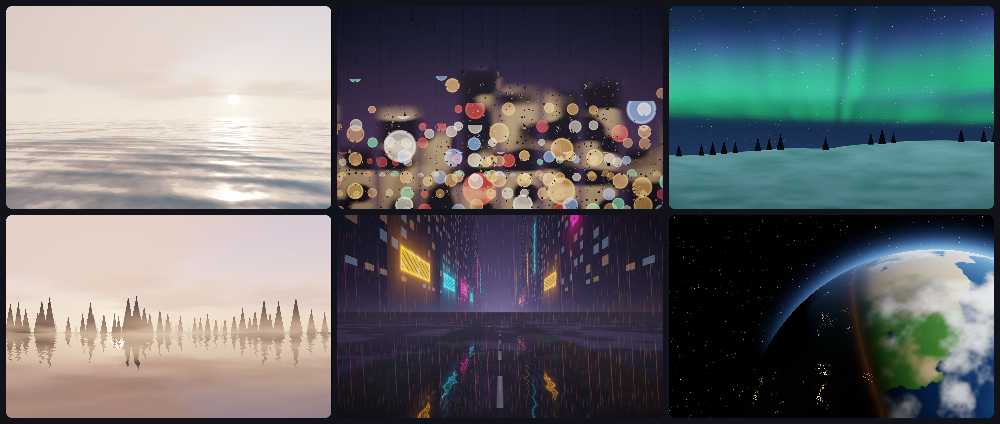
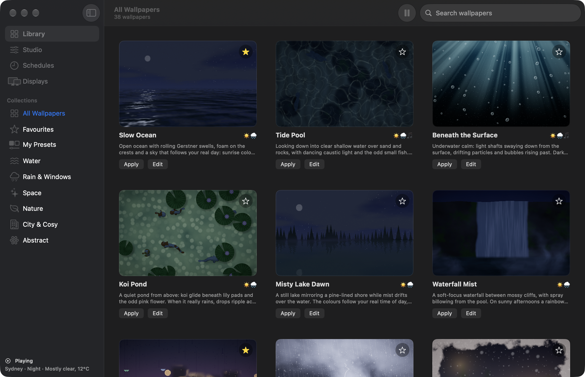
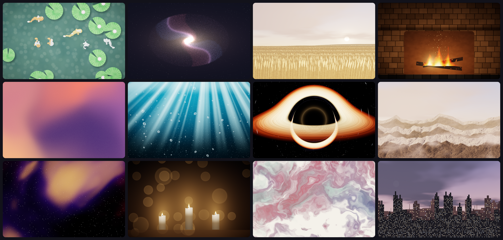

# Driftscape

**Live wallpapers for your Mac that follow your real sky, your local weather and your music.**
Oceans, rain on glass, aurora, fireplaces and more: 38 original wallpapers drawn live with Metal, gentle on your battery.

  

## Screenshots
| The Library | 38 wallpapers in six collections |
| --- | --- |
|  |  |

## Features
- **38 living wallpapers** in six collections: Water, Rain & Windows, Space, Nature, City & Cosy and Abstract. Every one is original and generated live, not a video loop.
- **Your real day.** The sun is calculated for where you are, so sunrise, golden hour, dusk and starry nights happen when they really do. The moon appears in its real phase, and Meteor Night gets busier on real meteor-shower nights.
- **Your real weather.** Clouds, rain, snow, fog, wind and storms from Open-Meteo, fading in gently (rain takes two minutes to arrive). Preview any weather from the menu bar.
- **Music, if you like.** Turn on music reactivity and wallpapers marked 🎵 breathe gently with what your Mac is playing. It's off by default and never flashes.
- **Studio.** Tweak every wallpaper with sliders, colours and palettes, randomize for happy accidents, and save your own presets.
- **Schedules.** A different wallpaper for dawn, day, golden hour and night, or a shuffle playlist, with smooth crossfades.
- **Every display.** One wallpaper everywhere, or a different one on each screen.
- **Lock screen too.** Your lock screen and Mission Control stay in step with the live wallpaper, and your own wallpaper comes back when you quit.
- **Export** a 5K still or a seamless 10-second video loop, and install the **Driftscape screen saver** with one click.
- **Easy on power.** 30 fps at 75% resolution by default, and a complete stop when windows cover the desktop, the screen is locked or asleep, or in Low Power Mode. Optional battery saver.
- Lives quietly in the menu bar. Light and dark mode, VoiceOver and keyboard support, and Reduce Motion is respected.

## Requirements
- A Mac with Apple Silicon (M1 or later)
- macOS 14 Sonoma or later (system-audio music reactivity needs macOS 14.2 or later)

## Install
1. [Download Driftscape.dmg](https://github.com/MilkshakeSR/Driftscape/releases/latest/download/Driftscape.dmg) and open it.
2. Drag **Driftscape** into **Applications**.
3. The first time, **right-click Driftscape and choose Open**, then click **Open** again. Driftscape isn't notarized by Apple, so macOS asks once.

## Updates
Driftscape checks for updates once a day and tells you when a new version is ready. You can also choose
**Check for Updates…** from the menu bar icon, or turn on automatic installs in **Settings → Updates**.

## Privacy
Your wallpapers, presets and settings stay on your Mac. There are no analytics or tracking.
What leaves your Mac: your approximate location (rounded to about 1 km) is sent to Open-Meteo to get the weather, city searches go
to Open-Meteo's place search, and update checks go to GitHub. Music is analysed live on your Mac and is never recorded, saved or sent anywhere.

## Report a problem
Choose **Help → Report a Problem…** in Driftscape, or [open an issue](https://github.com/MilkshakeSR/Driftscape/issues/new).

## Version history
See [all releases](https://github.com/MilkshakeSR/Driftscape/releases).
